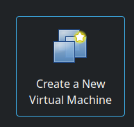
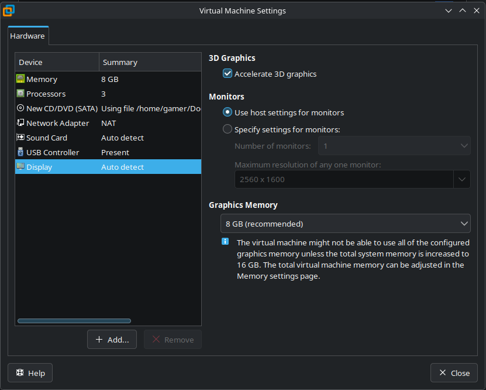

# VMware Setup

## :material-microsoft-windows: Windows iso

To start, you need either Windows 10 or 11 installation iso.

I recommend Windows 11 (despite how un-epic it is) and the .iso can be acquired here:

[Windows 11 iso](https://www.microsoft.com/en-us/software-download/windows11)

If you want, you can technically use Windows 10. That can be acquired here:

[Windows 10 iso](https://www.microsoft.com/en-us/software-download/windows10ISO)

## Create New Virutal Machine

With VMware open, create a new Virtual Machine 

Then do (any option not listed here is fine on the default):

Typical install

Use ISO image > Browse to the previously downloaded iso file.

Name it whatever, and choose where you would want it to be installed. The location does not matter, I recommend it's placed on an SSD drive though.

Enter a password that you can remember, it will autologon for you but do still remember it.

The disk size should be at a minimum 256gb, as you need room for all the software and projects.

### Then customize the hardware:

Memory > I recommend you set to *half* of what you currently have. Meaning if you have 16gb, you should give it 8gb.

Processors > Set the number of processors to 1, and the number of cores to half the amount of threads you have. If you are unsure how many cores/threads you have, look up your processor and see its specification.

Display > Ensure you have "Accelerate 3D Graphics" enabled.

Then close the Machine Settings and Finish.

If the option was enabled, the machine should automatically start for you after clicking Finish.

----

[Windows Setup](../First%20Time%20Setup%20Linux/Windows%20Setup.md)