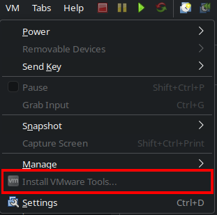
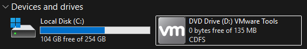

# Windows Setup

## Network issues

If you are unable to connect the Virtual Machine to the network, try running this on your Linux OS and try again:

`sudo systemctl enable vmware-networks.service`

## :fontawesome-solid-hand-middle-finger: Skip Microsoft Login

Let's get one thing out of the way, you don't want to login into your microsoft account for this. I mean, you're using linux for a reason to begin with.

When Prompted to login, press ++shift+f10++ on your keyboard. Command prompt should show.

Type in the following: `start ms-cxh:localonly` and press ++enter++.

It should prompt you for creating a local account instead.

As well along the way, when prompted for Privacy Settings. Turn all of them off, you don't need any of them.

## Updates and Drivers

Go ahead and run Windows and Microsoft Store updates. It might take a while.

Once all updates are installed, you want to install VMware Tools.

At the top bar for VMware, go to VM > install VMware Tools.

It might prompt you to download the Tools, go ahead and do so.

The installer gets mounted as a CD Drive in file explorer.

Right click on it, and click on "Install or run program from your media"

Typical install is what you want. Your screen may flash during install, and it might prompt you to restart the Virtual Machine.

## Debloat

There are multiple ways to debloat windows and reduce its size. I do not recommend you use something like [Atlas OS](https://atlasos.net/) :simple-atlasos:.

The tool I recommend you use is [Chris Titus Tech's Windows Utility](https://github.com/ChrisTitusTech/winutil).

You can either use a preset, or go through and choose what you do and do not need.

Generally a lot of windows apps can be removed, like One Drive, Microsoft Edge (if you want to use something else), Microsoft News, Outlook, etc.

## compactos

[Compactos](https://learn.microsoft.com/en-us/windows-hardware/manufacture/desktop/compact-os?view=windows-11) is a windows command that can compress the base operating system to also reduce size.

!!! danger
    Results can vary with this. Doing this will cost more CPU cycles, and can potentially lead to data loss. Only use this if absolutely needed.

Open CMD as an Admin and enter a command:

To Activate:
`compact /compactos:always`

To Disable:
`compact /compactos:never`

Check Status:
`compact /compactos:query`

----

[:material-folder-cog: Work Setup](../First%20Time%20Setup%20Linux/Work%20Setup.md)