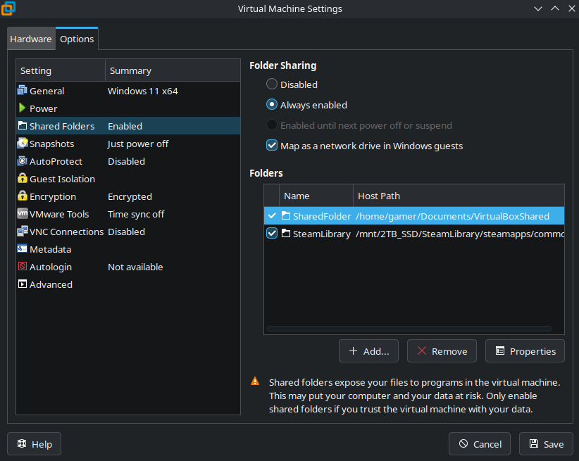

# Work Setup

This section can be skipped if you are already familiar with VMware and its features. Though I can almost deem it necessary for a proper workflow and saving on storage.

## Shared Folders

You obiously do not want to install Steam and install *another* copy of Payday 3 on your system. Especially since VMware can have shared folders between the virtual machine and your operating system.

What I recommend is you make a folder in your Documents (or wherever you find convienent) and name it something fitting for a shared folder.

Turn off the Virtual Machine if it is on. Then in the Virtual Machine settings (++ctrl+d++) go to the Options tab, and find Shared Folders.

Make sure it is to be always enabled, and Map as a network drive in Windows guests.

- Add the folder that was previously created

- As well add the directory to your installed copy of Payday 3

!!! info
    I personally made the Payday 3 directory read only, to help out potential permission issues in the future. You can make it read/write in this directory if you wish.

!!! warning
    As VMware discloses, this does expose parts of your Linux operating system to windows. Meaning it is more vulnerable to attacks executed on windows.

----

[Windows First Time Setup](../First%20Time%20Setup%20Windows/Windows.md)