# Unreal Project

## :simple-unrealengine: Blank UE Project

In the Epic Games launcher, open Unreal Engine (aka the Unreal Editor).

First time opening it may take a while.

!!! info
    If you're using VMware, you may see this:

    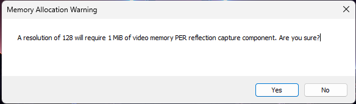

    Click yes

You are going to create a new project, name your project `PAYDAY3` and ensure you don't have any starter content.

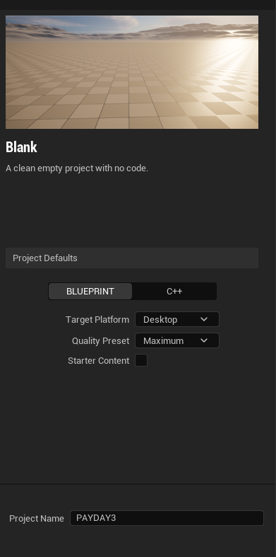

Once you create the project, it will load the project itself. This may take a while depending on your CPU speed, this will only happen on the first launch.

## Reduce Computer Resource Usage

Clicking on the 3 lines here:

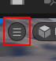

I recommend you disable `Realtime`

Then click on `Lit` and change it to `Unlit`

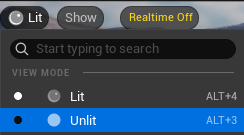

## Project Settings

Go to Edit > Project Settings

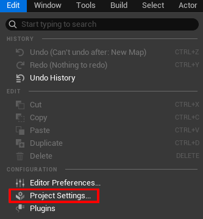

In the Search Bar, type in `Generate Chunks`

And enable `Generate Chunks`

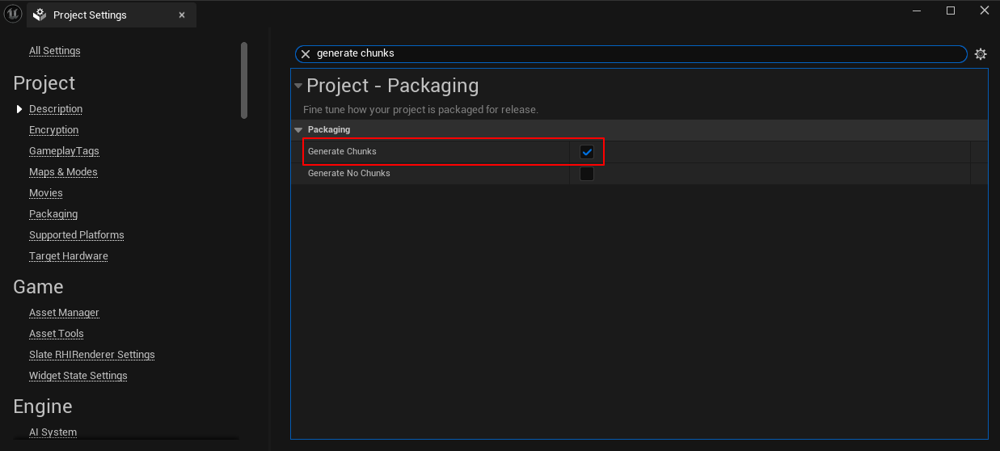

## Shipping Toggle

Click `Platforms` near the top.

Hover over Windows and enable `Shipping`

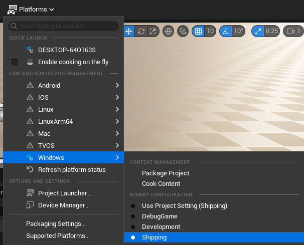

## :simple-wwise: Wwise Integration

Navigate to `Tools` from the top, and click `New C++ Class`

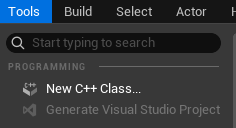

By default, it'll select "None", that's fine.

Click Next>

You can name it whatever you want, then click `Create Class`

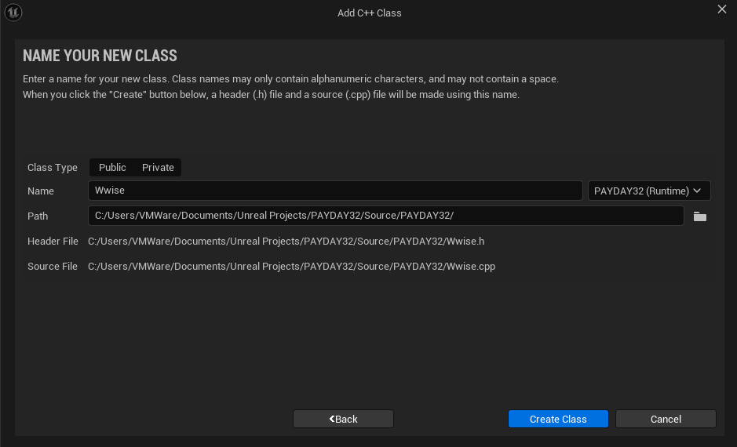

Once this appears, you click OK

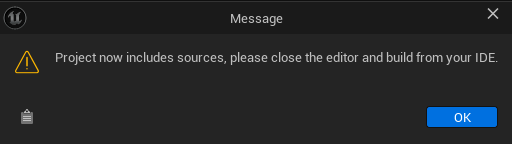

When this appears, click No

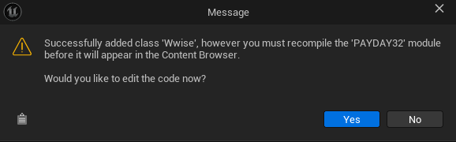

And now Close Unreal Engine.

Open the Wwise Launcher you previously installed, and navigate to Unreal Engine on the left side

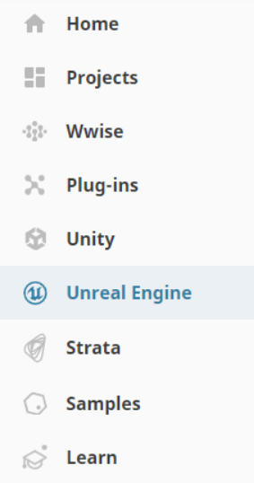

Click on `Integrate Wwise in Project...` next to the PAYDAY3 project.

Make sure the Integration Version is the one you previously installed:

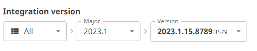

And under Wwise Project, make sure it points to the previously downloaded project.

Then click Integrate.

Once it's completed, go to your Unreal Engine project in file explorer. By default it's located in `Documnets/Unreal Projects`

Where the Unreal Engine Project file is, there should be a similarly named .sln next to it.

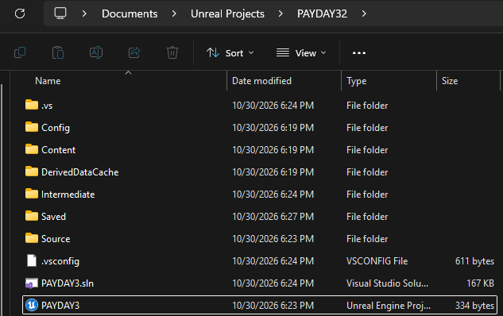

If you don't see one, right click on the Unreal Engine Project file and click on `Generate Visual Studio project files`

Open the .sln file by double clicking it, it might prompt what app to use to open the file. Use Microsoft Visual Studio 2022.

Once open, it may give you a temporary guide, just skim through it and you're not required to login.

At the top, you want to click `Build` then `Build Solution` (or press ++ctrl+shift+b++)

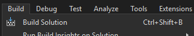

Wait for it to build, you will know if it completed with the purple line turning gray at the bottom.

Once completed, close Visual Studio and re-open your project.

Go into Edit > Project Settings

Scroll all the way to the bottom, and click on `Integration Settings`

Change the "Root Output Path" with the 3 dots, to the GeneratedSoundBanks folder located in the root of your Wwise Project.

Close Project Settings, and you should see the Wwise Browser on the right hand side.

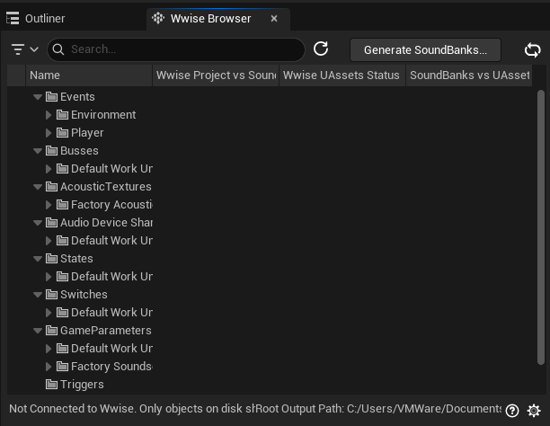

If you don't see this, go to Window > Wwise Browser

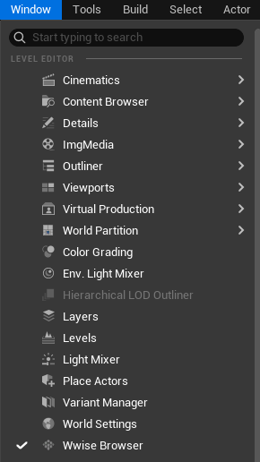

## Finished

That is all for the setup! You are now free to explore on your left to get general guiding on how to use Wwise.