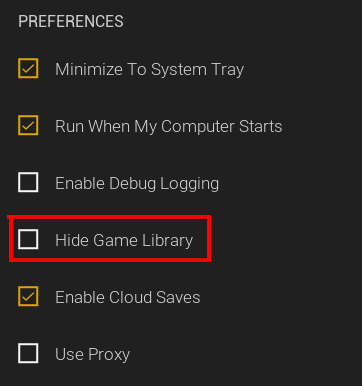
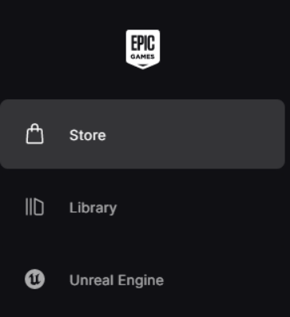
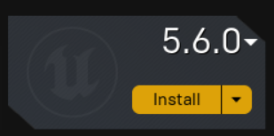
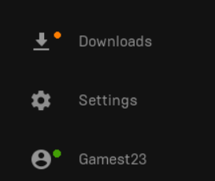

## Epic Games

We need a specific version of Unreal Engine. To install Unreal Engine, we need the [Epic Games Launcher](https://store.epicgames.com/en-US/download) :simple-epicgames: (don’t worry, it won't add Fortnite to your account). Yes, you do need to make an account if you already don’t have one.

While you’re in the Epic Games Launcher, go ahead and claim the free game of the week on the Store tab of the app. You can do this every week, and it is a different game, just a gamer tip.

!!! info
    Optionally, if you don't want to use the Epic Games launcher as an actual game library, you can hide the store and library under settings.
    
    

    Not shocking at all, it also makes it run faster.

On the top left of the Epic Games Launcher, there will be 3 options. We want to select Unreal Engine.

Then at the top, there will be different tabs. Go ahead and click the “Library” option.

Near where you just clicked, there should be the option to install a new version of UE, click the plus sign and a new UE instance should appear grayed out.

We do not want the latest version of UE, as Payday 3 uses version 5.5.4 as of Update 3.8

To change the version to install, click the version number and a small menu will appear with all the options. Just find 5.5.4 and click on it.

Then click install. A menu might pop up and say where you want to install this, just let it use the default location and click Install.

This might take a while, depending on your internet speed. You can check your install speed with the “Downloads” option in the lower left corner.

Once done, we can move on to Wwise.

----

[Installing Wwise](../First%20Time%20Setup%20Windows/Wwise.md)