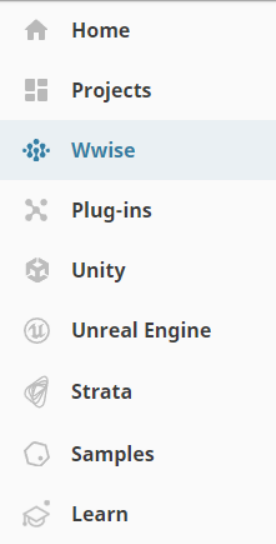
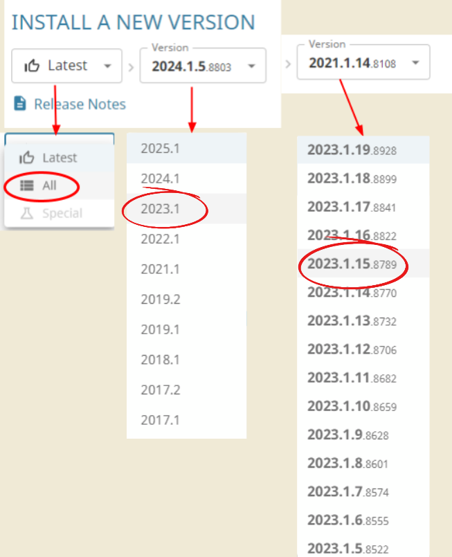
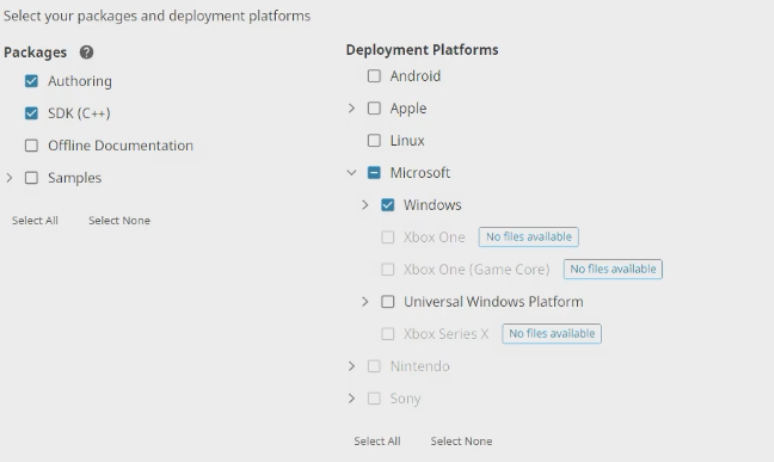

## Wwise Launcher

Go ahead and install the [AudioKinetic Launcher](https://www.audiokinetic.com/en/download/). Yes, you do have to make an account with them to install and “activate” the launcher. (make sure to remember your login information, since you need it later)

Once you can download the .exe file, open it and go through the installer.

With the launcher installed and now open, click the “Log in” option at the top right of the app to login. Make sure the “Keep me logged in” option has a blue checkmark.

On the left side, there is a Wwise tab, click it

At the bottom where it says to Install A New Version, change `Latest` to `All`

Then under Major, select version `2023.1`

Then under Version, select version `2023.1.15.8789`

Then click Install

In the new menu, you want to make sure the following has a blue check mark:

Authoring

SDK (C++)

Windows

Then click Next. Ignore the next screen and click Install. And accept.

This also might take a while, depending on your internet speed.

At this point, we have done a lot, to make sure everything will work smoothly, go ahead and restart your computer and continue.

----

[:fontawesome-solid-computer: Post Restart](../First%20Time%20Setup%20Windows/Post%20Restart.md)