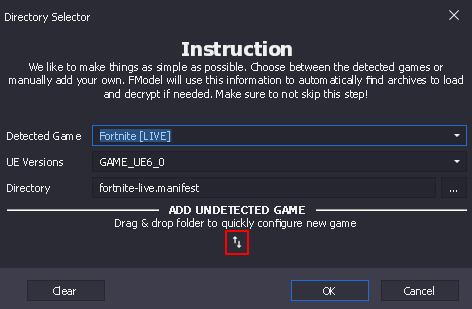
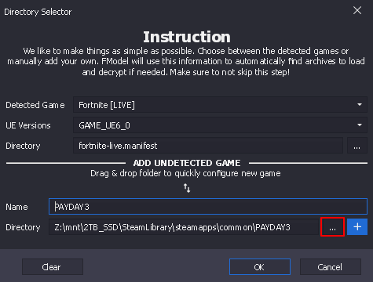
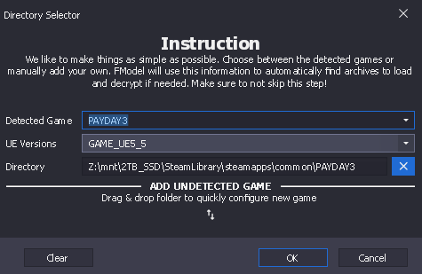
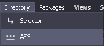
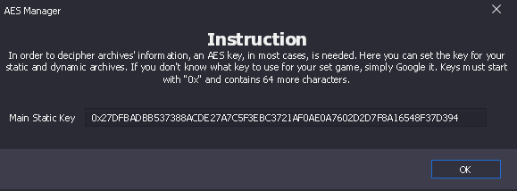
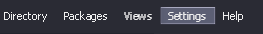
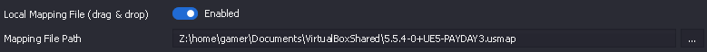

# :Fmodel-fmodel: Fmodel

## Download

Download Fmodel here: [fmodel.app](https://fmodel.app/)

Extract the .exe file from the .zip file into a dedicated folder, located somewhere like your desktop.

Open `FModel.exe`

With this window open, you want to click on the up and down arrows beneath "ADD UNDETECTED GAME"

In the Directory field, click the 3 dots, and navigate to your Payday 3 install directory. Use/open the root folder for Payday 3, then click the blue plus button.

The "Detected Game" field should now be `PAYDAY3`

The "UE Versions: should be `GAME_UE5_5`

And click OK

## AES

Under Directory, click AES

And enter the following:

`0x27DFBADBB537388ACDE27A7C5F3EBC3721AF0AE0A7602D2D7F8A16548F37D394`

And click OK.

## Mapping File

Download the [Mapping File](dwn/PAYDAY3-5.5.4-0+UE5-unknown.usmap) (10/29/2026) and place it where the FModel.exe is located

!!! warning
    Mapping files can get outdated in a matter of a Payday 3 update. Latest versions can be either found here, the official [Modworkshop discord :simple-discord:](https://discord.gg/Eear4JW), part of the Modkit, or by generating your own. [See here for more details](https://payday3-modding.github.io/Documentation/payday3-modding/getting-started/fmodel-setup.html#_get_a_mappings_file)

Click Settings at the top

Enable and add the Mapping file either by dragging the file onto it, or clicking the 3 dots and going to its directory.

## Our use case

Having the "Loading Mode" set to All, then clicking `Load` pulls up a list of Payday 3's assets.

Go to `PAYDAY3 > Content > WwiseAudio > Events`

This is the folder of assets we replace to make Wwise Event audio mods.

Opening any of the assets in here will just play the audio tied to them, not 100% useful.