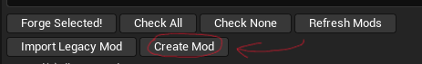
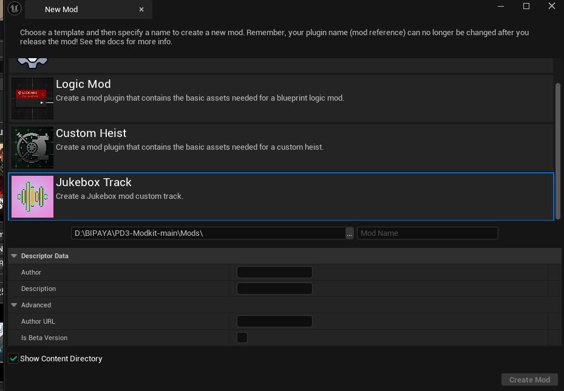
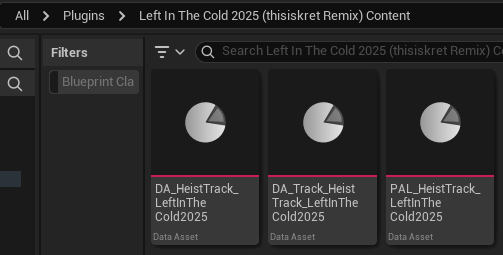
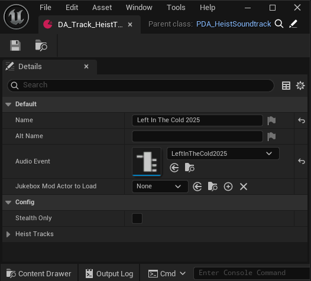
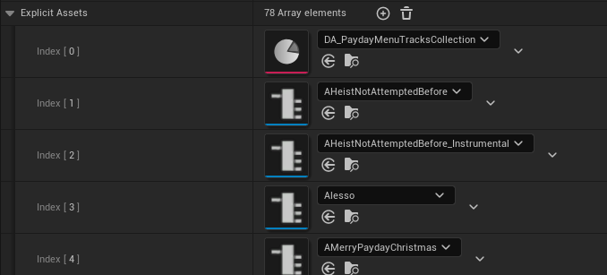
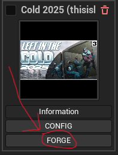

# Making it an Add-on

## Creating The Mod

In Unreal Engine, you want to click the Crimeforge button at the top. In the new menu that pops up, you want to click “Create New Mod…”

A menu should pop up, Make your mod a Jukebox Track Mod and fill in the relevant details.

Once it’s done, you want to click on “Create Mod” on the lower right of the CrimeForge Window.

Since this is an add-on for the Updated Heist Jukebox, the steps are different.

## The Add-on part

In the Content Browser, start here at your Mod's Plugin Folder:

You can click on your mod on the Crimeforge window to reach this spot

Open the included Data Asset for the Heist Track by double-clicking on it. (The one starting with DA_Track)

The Name field will be the name that will appear in-game for the Jukebox Mod.

The Audio Event is going to be the Event you made for this. Click on the drop down, search for the name you gave it, and click it.

Once you filled out both fields, click `Compile` on the top left.

## Packaging The Audio

After that you will now need to grab your mod's pal and drag your wwise events/Input the wwise events you wish to import to the Explicit Assets filed so its audio can be fetched and packaged with the mod you forge.

!!! note
    Remember! You must drag your custom wwise events into your modkit's Wwise directory via the Wwise Browser so you can properly reference it! Make sure to always import them like how it shows in the Wwise Browser!

When finished, save your PAL and forge your mod with the CrimeForge menu!

Finally grab the zip from your modkit's \Saved\ArchivedPlugins directory and you are done!
