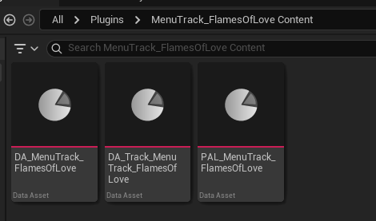
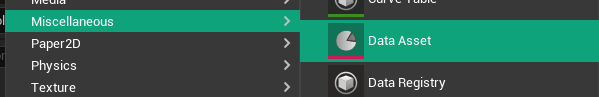
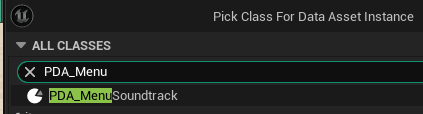
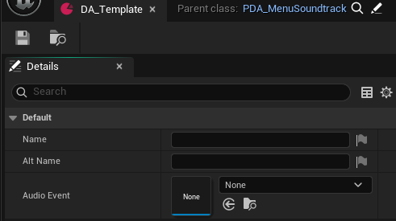
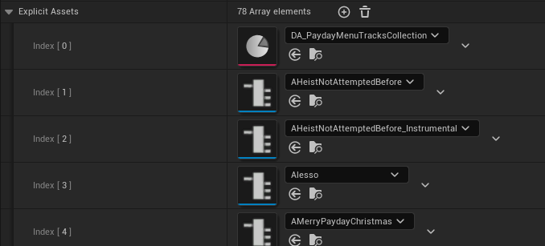
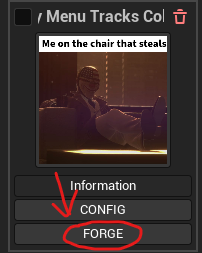

# Making it an Add-on (MODKIT REQUIRED)

## Dependencies

For Menu tracks that are not intended as replacements, users must install the Updated Jukebox plugin for their modkit to have support for their chosen menu track.

This can be done via using the PDML Modkit Bat file to pull the latest commit changes/install to your modkit or via the [mod's github page](https://github.com/braidy08/JukeboxMod)

## Creating the Jukebox Mod

In the modkit, you want to click the Crimeforge icon on the top of the modkit project window to “Create a Mod" with it. Make this a Jukebox Track mod and fill in the relevant details.

After the creation of the mod, you will see the mod's Data Asset, Primary Asset Label, and the Data Asset of the track.

After this, you will need to delete the DA of the Track as, currently, creating a Jukebox Mod will default to making a Heist Track Data Asset instead of a Menu Track Data Asset which is what's really needed.

## Creating The Menu Track Data Asset

Right click on the empty space in your mod's content folder, and click `Data Asset` under Miscellanous

With the new window that popped up, you want to search or `PDA_MenuSoundtrack`

Click on it, and click Select

I recommend you name it starting with `PDA_` then your song name. You can rename it by selecting it, and pressing ++f2++.

Open the new Data Asset by double-clicking on it.

The Name field will be the name that will appear in-game for the Jukebox Mod.

The Alt Name field is the alternative name of the track if you wish (usually this is the name of the track officially)

The Audio Event is going to be the Event you made for this. Click on the drop down, search for the name you gave it, and click it.

Once you filled out both fields, click `Save` on the top left.

## Packaging The Audio

After that you will now need to grab your mod's pal and drag your wwise events/Input the wwise events you wish to import to the Explicit Assets filed so its audio can be fetched and packaged with the mod you forge.

!!! note
    Remember! You must drag your custom wwise events into your modkit's Wwise directory via the Wwise Browser so you can properly reference it! Make sure to always import them like how it shows in the Wwise Browser!

When finished, save your PAL and forge your mod with the CrimeForge menu!

Finally grab the zip from your modkit's \Saved\ArchivedPlugins directory and you are done!
