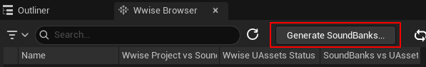
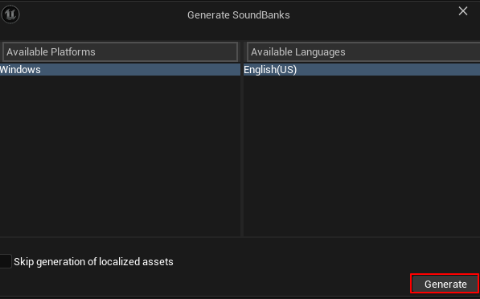
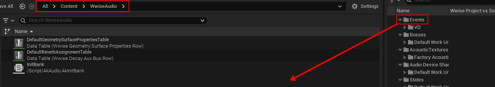

# This Section is for an empty Unreal Project only

## Generate Soundbanks...

In the Wwise Browser within the Unreal Project, click `Generate Soundbanks...`

Then `Generate`

Once it's done, go to the "WwiseAudio" directory under "Content". From the Wwise Browser, click and drag the "Events" folder into the "WwiseAudio" folder.

!!! info
    If you already have an Events folder within the WwiseAudio directory, and this is your second time making a mod. Delete the Events folder within WwiseAudio, or move it somewhere else.

----

[:fontawesome-solid-chart-pie: Making a PAL](./Making a PAL.md)