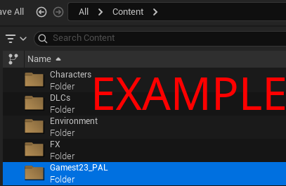
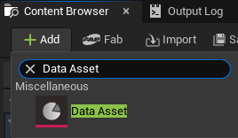
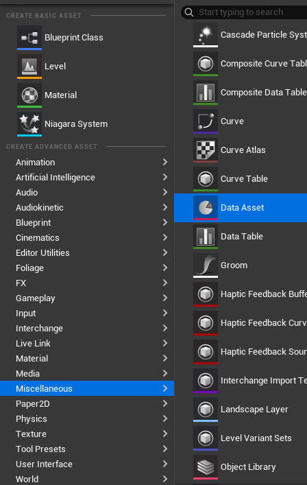
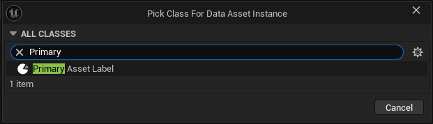
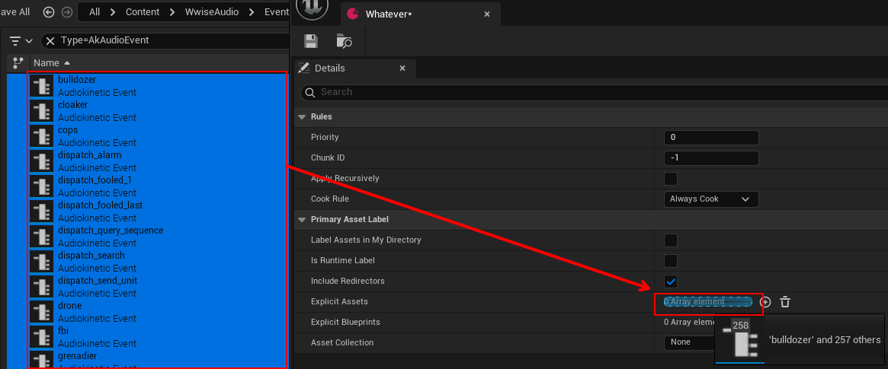
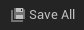
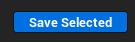

## Making a Data Asset

??? "If this is your first time"
    I recommend you create a folder in "Content" named: `YourUserName_PAL`

    For example, if I made this folder, I would name it: `Gamest23_PAL`

    

Either Right-Click an empty space, or click `+ ADD`

Then either Search for `Data Asset`

Or go to:

Miscellaneous > Data Asset

Within the Search, type `Primary` and click `Primary Asset Label`

Name it whatever you wish, and open it by Double-Clicking on the new Asset.

The following fields need to be modified:

??? Priority
    This sets the load priority for assets, the higher the number, the higher the priority.

    For example: if Mod1 had a priority of 3, and Mod2 that replaces the same assets as Mod1 had a priority of 4, Mod 2 wins.

??? "Chunk ID"
    This field is to be set a number above zero, and to **not** conflict/share with other PAL's ID. This assigns the ID to the cooked assets and needs to be remembered later.

`Cook Rule` Needs to be set to `Always Cook`

`Is Runtime Label` Needs to be `Enabled`

`Include Redirectors` is not necessary to be `Enabled` or `Disabled` for the output of your mod.

## Explicit Assets

This is where your Wwise Events go.

In the Content Browser, go to the "WwiseAudio" folder and open the "Events" folder.

Either go folder by folder and find the Events :Wwise-event:, or in the `Search Content` type "Event" and click `AK Audio Event`.

Select the Events :Wwise-event:. Either by clicking on them, then ++ctrl++ clicking the others. Or press ++ctrl+a++ to select everthing.

Then, click and drag them into the `Explicit Assets` field.

You can now save the PAL by either doing `Save All` and `Save Selected`.

 

Or by clicking on this icon:

----

[Package Project](Package Project.md)