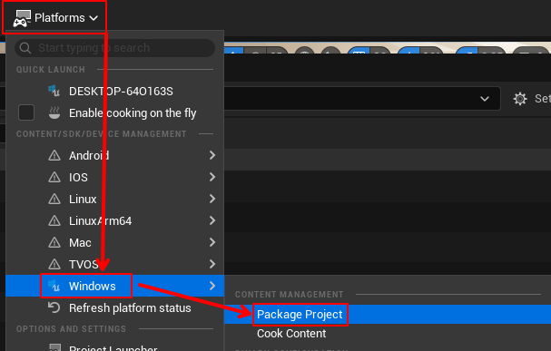
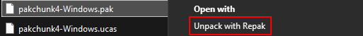
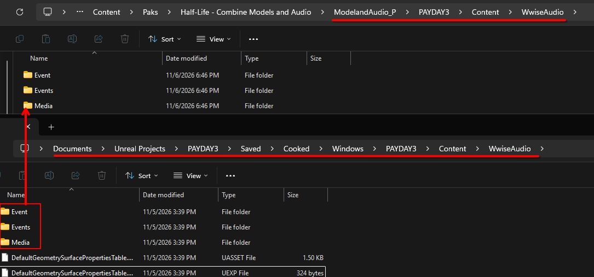
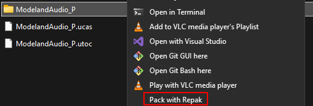
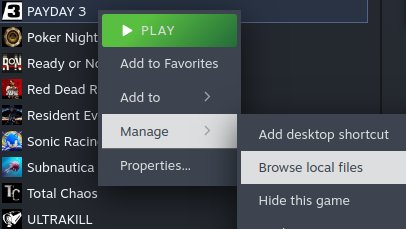

## Packing Project

Click `Platforms`, then hover over `Windows`, and click `Package Project`

It will prompt where you would like to Package the Project. I personally made a folder on my desktop named `UE5 Output` and direct it there everytime.

This will prompt every time you do this, and you can have it output to the same folder every time.

!!! note
    If this is your first time doing this, this may take a while.

## Getting Ready for Usage

Once the notification from Unreal Engine disapears, go to the folder you pointed it to previously.

Then go to:

`Windows > PAYDAY3 > Content > Paks`

Inside will include files that have `pakchunk#-Windows.ucas` `.utoc` and `.pak`

The files you want are the ones where the number (the # in the example above) matches the Chunk ID you put in for your PAL.

For example, if you put the Chunk ID as 1. Then the three files you want are the ones labeled `pakchunk1-Windows`

Once you found them, create a new folder. Name it to what your mod name is. Then place the three files mentioned previously, inside that new folder.

You need to re-name those 3 files. The name itself does not matter. What **does** matter, is at the end you put `_P`. Without it, your mod will not load.

Example: `WalkingSFX_P`

## Media Files

Before we can add this to Payday 3, we need the media/audio files.

Right-Click the .pak file, and Unpack with Repak.

Then delete the .pak file.

Open the new folder, and you need to create several folders inside to match this directory:

`PAYDAY3 > Content > WwiseAudio`

----

Now, in a new file explorer instance, navigate to your Unreal Engine Project files. By default, it's located in:

`Documents > Unreal Projects > YourProjectName`

Within your project's files, navigate to:

`Saved > Cooked > Windows > YourProjectName > Content > WwiseAudio`

You're going to copy the following folders:

`Event`

`Events`

`Media`

To the WwiseAudio folder you made previously.

----

Now navigate back to where you originally unpacked the .pak file.

Select the folder that is next to your `.utoc` and `.ucas`, Right-Click and `Pack with Repak`.

Then delete the folder.

## Testing

Put your mod's main folder (the folder you made, and placed files inside) to:

`PAYDAY3 (root) > PAYDAY3 > Content > Paks > ~mods`

Create the folder `~mods` if you don't have one.

!!! note
    If you do not know where Payday 3 is installed on your device:

    Go to your Steam Library and Right-Click on Payday 3. Then hover over `Manage`, then click `Browse local files`

    