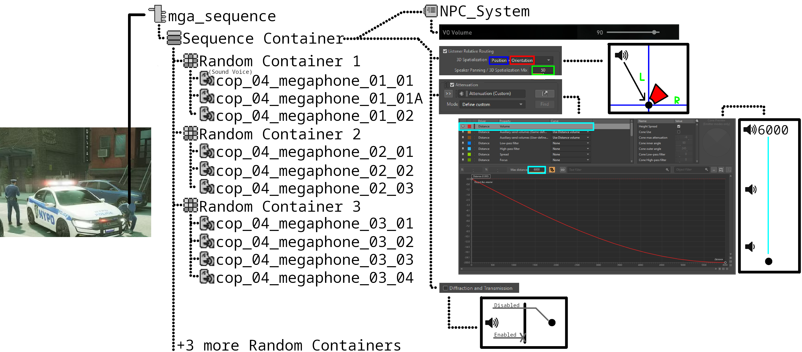
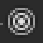

# Top to Bottom

Payday uses Wwise

Wwise uses Events

Events then Play, Stop, Break, Seek, [and more](https://www.audiokinetic.com/en/public-library/2023.1.19_8928/?source=Help&id=event_actions_list) with Containers

Containers then have next to full control on how exactly you want your audio to play and sync with Payday.

We'll start with an example of how a vanilla Event looks (roughly).

The example image shows a rough visual on the overall structure and behaviour of the options and containers. If you want to view it closer, you can right click on the image and open it in a new tab.

??? Icons
     Event

     Sequence Container

     Random Container

     Sound Voice

     Audio Bus

     Attenuation

??? ":Wwise-event: Event"
    The Event in this example does one thing, play the Sequence Container.

??? ":Wwise-sequencecontainer: The Sequence Container"
    They play a playlist organized by you. In the example it plays the random containers from 1 to 5, moving on to the next container in the playlist once the current one has concluded.

??? ":Wwise-randomcontainer: The Random Container(s)"
    They play a playlist, though in this case it plays *one* of them randomly and ends. This is the behaviour by default.

??? ":Wwise-audiobus: Output Bus"
    The output bus, for the sake of simplicity, is the assignment of the in-game volume controls.

??? "Listener Relative Routing"
    ^^3D Spatialization^^ are factors you want to have when audio is playing externally from the player (you). Whether you want Position to be considered, and or Orientation (where the player's camera is facing) to be considered as well.

    ^^Speaker Panning/3D Spatialization Mix value^^ is how aggressive do you want the external source to be playing in a speaker direction. For example, stereo has 2 channels/speakers, left and right, having this field at 100 would mean if it is playing in the player's left side would *only* play on their left ear. Having it at 0 would essentially mean a mono output, where it would play in both channels at equal levels in stereo.

??? ":Wwise-attenuation: Attenuation"
    This is only used, at least in our use case, for having distance be considered in lowering the volume when further away from the source. A lot of the time you want to use the value used in-game, which will be provided in the guides.

??? "Diffraction and Transmission"
    This toggle option does one thing. Whether you want the audio to passthrough walls and floors or not. If you want the audio to respect walls and floors, enable it.

There is a lot to consider when making mods with Wwise, though at the same time it offers almost absolute control for your audio mods in behaviour completely.

You can truly do what you wish in the audio's volume and behaviour using this software. The guides listed on the left is to truly point the path of the Event that plays what you wish to replace, and general guidance for things such as Switches and States. What you do with it and how it behaves is completely up to you.

Using something like [Payday Audio Modder](https://modworkshop.net/mod/51045) :Icons-mws_logo_white::Icons-mws_logo_black:, means (using the above image as an example) you are replacing the Sound Voice files only. The behaviour being up to what Starbreeze developers chose, not yours.
