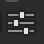
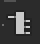
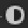
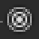

# Wwise information

This page is to link containers to the official documentation for this version of Wwise, organized by their tab within Wwise.

If you wish to know more on how to use Wwise overall, go here: [:fontawesome-solid-folder-tree: Structure](Structure.md)

These guides use version `2023.1.15.8789`

This is their guide and documentation of the software/engine (warning light mode). [Welcome to Wwise 2023.1.19](https://www.audiokinetic.com/en/public-library/2023.1.19_8928/?source=Help&id=welcome_to_wwise) :Icons-audiokinetic:

(the version number does not match completely, though will still be accurate)

All audio is **REQUIRED** to be in the .wav format.

## Shortcuts/Hotkeys

++ctrl+s++ To save your Project

++left-shift+w++ Open Music Editor

[Keyboard Shortcuts and Custom Commands](https://www.audiokinetic.com/fr/public-library/2023.1.19_8928/?source=Help&id=keyboard_shortcuts) :Icons-audiokinetic:

## Containers and More

 [Audio Bus](https://www.audiokinetic.com/en/public-library/2025.1.12_9287/?source=Help&id=building_structure_of_output_busses#the_master_audio_bus_hierarchy) :Icons-audiokinetic:

 [Work Unit](https://www.audiokinetic.com/en/public-library/2025.1.12_9287/?source=Help&id=managing_workgroups#what_are_work_units) :Icons-audiokinetic:

 [Virtual Folder](https://www.audiokinetic.com/en/public-library/2023.1.19_8928/?source=SDK&id=ak_wwise_core_object_create_example_creating_a_virtual_folder.html) :Icons-audiokinetic:

 [Actor-Mixer](https://www.audiokinetic.com/en/public-library/2025.1.12_9287/?source=WwiseFundamentalApproach&id=the_project_hierarchy#understanding_actor_mixer_hierarchy) :Icons-audiokinetic:

 [Random Container](https://www.audiokinetic.com/en/public-library/2023.1.19_8928/?source=Help&id=creating_random_container) :Icons-audiokinetic:

 [Sequence Container](https://www.audiokinetic.com/en/public-library/2023.1.19_8928/?source=Help&id=creating_sequence_container) :Icons-audiokinetic:

 [Switch Container](https://www.audiokinetic.com/en/public-library/2023.1.19_8928/?source=Help&id=overview_switch_container) :Icons-audiokinetic:

 [Blend Container](https://www.audiokinetic.com/en/public-library/2023.1.19_8928/?source=Help&id=overview_blend_container) :Icons-audiokinetic:

 [Sound SFX](https://www.audiokinetic.com/en/public-library/2023.1.19_8928/?source=Help&id=creating_wwise_objects_on_import) :Icons-audiokinetic:

 [Sound Voice](https://www.audiokinetic.com/en/public-library/2023.1.19_8928/?source=Help&id=creating_wwise_objects_on_import) :Icons-audiokinetic:

----

 [Music Switch Container](https://www.audiokinetic.com/en/public-library/2023.1.19_8928/?source=Help&id=overview_music_switch_container) :Icons-audiokinetic:

 [Music Playlist Container](https://www.audiokinetic.com/en/public-library/2023.1.19_8928/?source=Help&id=overview_music_playlist_container) :Icons-audiokinetic:

 [Music Segment](https://www.audiokinetic.com/en/public-library/2023.1.19_8928/?source=Help&id=creating_wwise_objects_on_import) :Icons-audiokinetic:

 [Music Track](https://www.audiokinetic.com/en/public-library/2023.1.19_8928/?source=Help&id=overview_music_track) :Icons-audiokinetic:

 [Transition](https://www.audiokinetic.com/en/public-library/2023.1.19_8928/?source=Help&id=working_with_transitions) :Icons-audiokinetic:

----

 [Event](https://www.audiokinetic.com/en/public-library/2023.1.19_8928/?source=WwiseFundamentalApproach&id=understanding_events) :Icons-audiokinetic:

----

 [Switch Group](https://www.audiokinetic.com/en/public-library/2023.1.19_8928/?source=SDK&id=wwiseobject_switchgroup.html) :Icons-audiokinetic:

 [Switch](https://www.audiokinetic.com/en/public-library/2025.1.12_9287/?source=Help&id=working_with_switches_working_with_switches#creating_switch) :Icons-audiokinetic:

 [Game Parameter](https://www.audiokinetic.com/en/public-library/2025.1.12_9287/?source=Help&id=managing_game_parameters_used_in_rtpcs#creating_game_parameter) :Icons-audiokinetic:

 [State Group](https://www.audiokinetic.com/en/public-library/2023.1.19_8928/?source=SDK&id=wwiseobject_stategroup.html) :Icons-audiokinetic:

 [State](https://www.audiokinetic.com/en/public-library/2023.1.19_8928/?source=SDK&id=concept_state.html) :Icons-audiokinetic:

----

 [Attenuation](https://www.audiokinetic.com/en/public-library/2023.1.19_8928/?source=Help&id=applying_distance_based_attenuation) :Icons-audiokinetic: